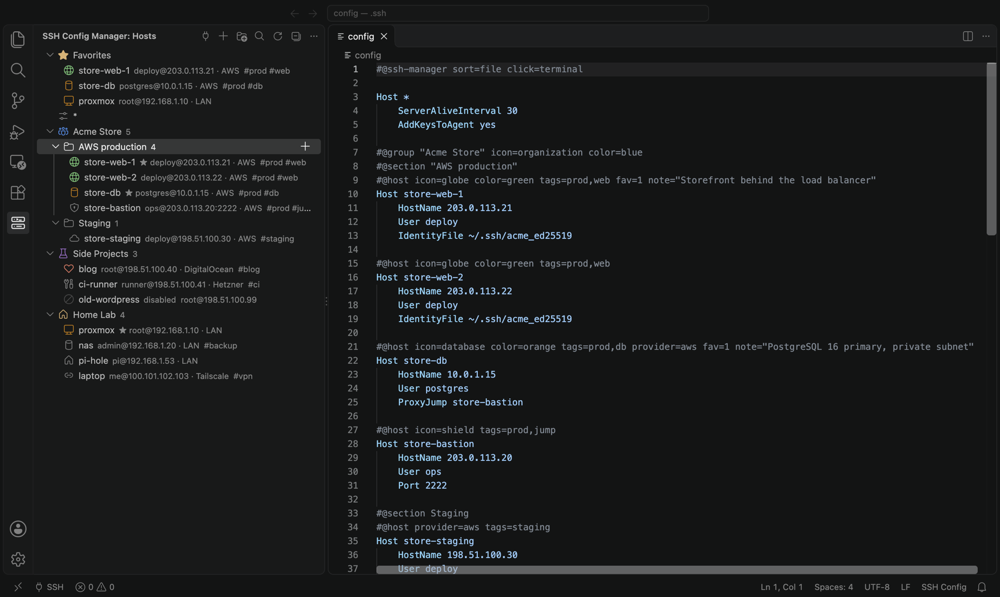
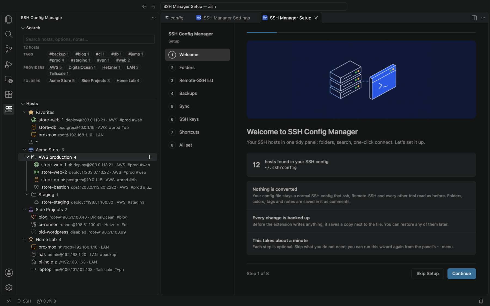
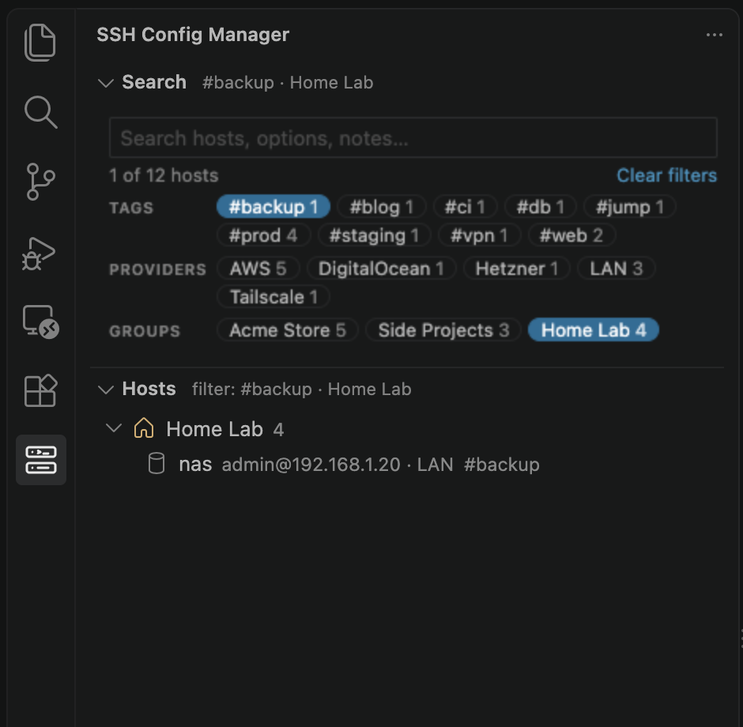
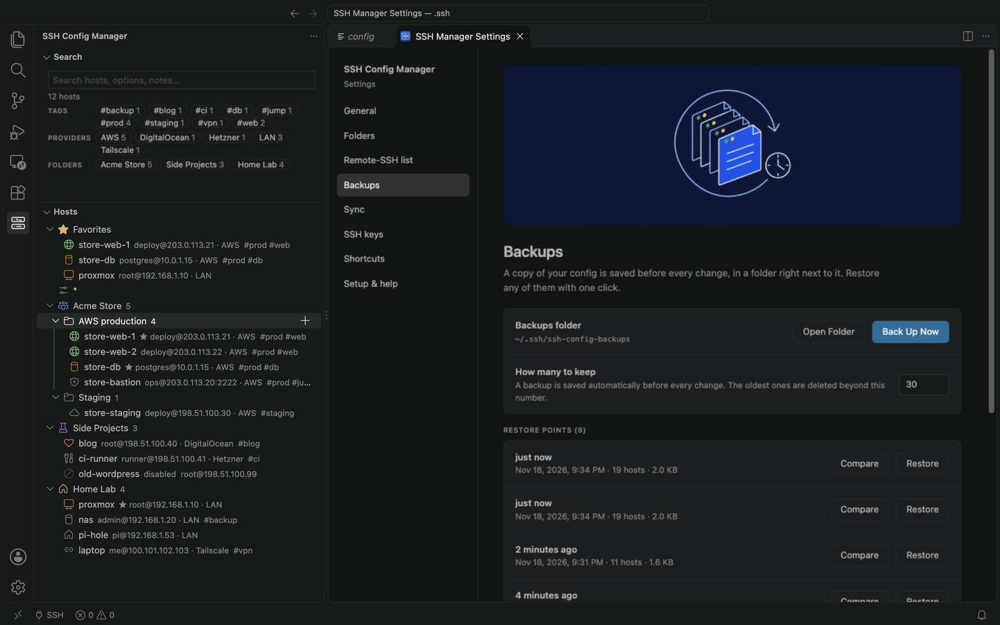
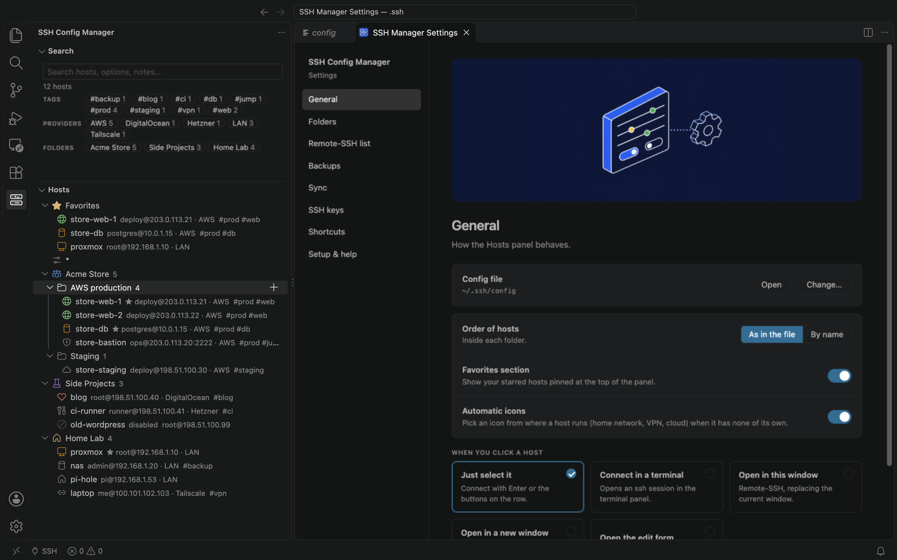
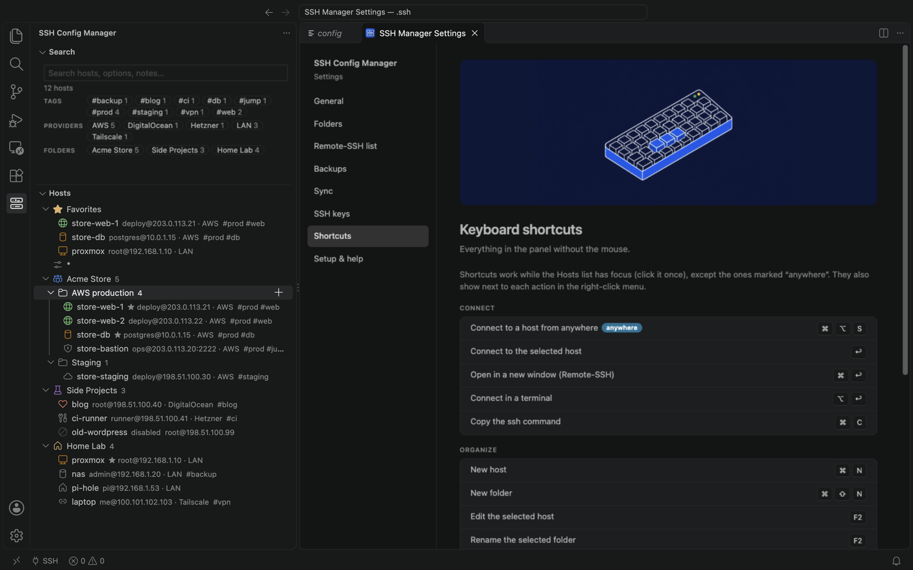

<p align="center">
  
</p>

<h1 align="center">SSH Config Manager</h1>

<p align="center">
  Your SSH hosts in one tidy panel inside VS Code: folders, search, one-click connect, backups and sync —<br>
  all stored as comments <b>inside your normal SSH config file</b>.
</p>

<p align="center">
  <a href="https://marketplace.visualstudio.com/items?itemName=vrxt.ssh-config-manager"></a>
  <a href="https://marketplace.visualstudio.com/items?itemName=vrxt.ssh-config-manager"></a>
  <a href="https://github.com/VRXT/ssh-config-manager/actions/workflows/ci.yml"></a>
  <a href="LICENSE"></a>
</p>



The file stays the single source of truth. Everything the panel adds is a `#@…` comment line that
OpenSSH ignores, so `ssh`, Remote-SSH and every other tool keep working exactly as before.

## What you get

- **Folders and subfolders** for your hosts, with icons, colors, tags, notes and favorites
- **Search** as you type, plus one-click filters by tag, provider and folder
- **Connect** in a terminal or through Remote-SSH, straight into a folder on the server if you like
- **A tidy Remote-SSH list**: VS Code's own "Connect to Host" list gets the same folders, with headings and gaps
- **Backups** next to the config file before every change, with one-click restore
- **Sync** between your computers through a file in Dropbox, iCloud Drive or OneDrive
- **SSH key help**: see which hosts need a key that is not on this computer, and set one up in one step
- **Keyboard shortcuts** for almost everything, shown in the menus
- **A setup wizard** on first run and a **settings page** you can open any time

## Get started in a minute

Install **SSH Config Manager** from the Marketplace (or `ext install vrxt.ssh-config-manager`).
The setup wizard opens the first time and walks through everything, one screen at a time. Every step
is optional, and you can run it again whenever you like: **⋯ → Setup Wizard** in the Hosts panel.



Your existing `~/.ssh/config` is listed right away. Nothing is converted, and nothing is written until
you change something. Prefer VS Code's own checklist? The same steps are on the **Get Started** page
(**SSH Manager: Open the Get Started Guide**).

## Folders

A folder holds hosts and subfolders, like in Finder or Explorer: a folder per project or customer,
subfolders such as *Production* and *Staging* inside.


- **New Folder** / **New Subfolder** from the toolbar or the right-click menu
- **Drag a host** onto a folder to move it, or onto another host to place it next to it
- **Rename, move, color, icon** on any folder; **Enable / Disable** hides a whole folder from `ssh` without deleting it
- **Hover a host** for its note, folder, tags, provider and jump host
- **Provider detection**: LAN, Tailscale, AWS, Hetzner, DigitalOcean, Azure, Google Cloud, OVH, …
- Hosts from `Include`d files are listed read-only

<br clear="right">

### Search and filter



The **Search** panel sits above the host list:

- Type to filter instantly. Every word must match somewhere: name, HostName, User, Port,
  IdentityFile, ProxyJump or any other option, tags, note, folder or provider.
- Click tags, providers and folders to narrow the list. Several picks in one row mean *any of them*;
  picks in different rows must *all* match.
- Folders open automatically while a search is on, and go back to how you left them when you clear it.

<br clear="right">

### Edit hosts in a form

HostName, User, Port, several IdentityFiles, ProxyJump, a remote folder, and any raw extra options.
Only that host's lines are rewritten; every other line of the file is kept byte for byte.


## Connect your way

Connect in a terminal, or open the host in this / a new window through Remote-SSH: from the buttons on
the row, the right-click menu, `Enter`, or the quick picker (`Cmd+Alt+S` on macOS, `Ctrl+Alt+S`
elsewhere, or the **SSH** button in the status bar).


**Not only in Microsoft's VS Code.** Opening a host in a window uses whichever SSH extension your
editor has: *Remote - SSH* in VS Code, Cursor's own in Cursor, *Open Remote - SSH* in VSCodium and
other builds. If none is installed, you are told which one to get. Connecting in a terminal needs
nothing extra.

**Open a folder directly.** Give a host a *remote folder* such as `/var/www/html` (in the edit form, or
right-click → **Set Remote Folder…**). **Open in Window** then opens that folder on the server instead
of an empty window, and **Connect in Terminal** starts the shell there.

## A tidy Remote-SSH list

VS Code's own **Remote-SSH: Connect to Host** list shows every host in one long row and cannot be
themed. SSH Config Manager gives it the same structure as the panel: a heading for every folder and
subfolder, a blank row between folders, and your favorites on top.


It is **on by default** as soon as you have folders, and you are told the first time it is applied.
The rows are harmless extra `Host` lines in the config file; one switch in **Settings → Remote-SSH list**
(or **SSH Manager: Format Remote-SSH Host List…**) removes them again.

## Backups and restore

Before every change, a copy of the config is saved in a folder right next to it:

```
~/.ssh/config
~/.ssh/ssh-config-backups/config-2026-11-18_21-05-33.bak
```

- **Restore from Backup…** lists them newest first, lets you compare with the current file, and backs
  up the current file before restoring, so a restore can be undone too
- **Back Up Now** takes one on demand
- The newest 30 are kept (change it in **Settings → Backups**, or `sshManager.backup.keep`)

They are plain copies of the config, so you can also restore one by hand.



## Sync between computers

Use the same hosts on every computer through a file in a folder that Dropbox, iCloud Drive or OneDrive
keeps in sync. Run **SSH Manager: Set Up Sync Between Computers…** (or **Settings → Sync**), pick a
way, pick the file, and do the same on your other computers with the same file.


| Way | What happens | Good to know |
|---|---|---|
| **Copy both ways** (recommended) | Your config stays a normal local file. Every change is copied to the shared file, and changes from your other computers are copied back, with a backup first. | Works on macOS, Windows and Linux, and offline. If both sides changed, you choose which to keep; the other is saved as a backup. |
| **Link to the shared file** | Your config becomes a symbolic link to the shared file. One real file. | Windows needs Developer Mode or administrator rights for links. |
| **Include the shared file** | `~/.ssh/config` keeps one `Include "<shared file>"` line and the extension edits the shared file. | Anything else you put in `~/.ssh/config` stays on that computer only. |

Turning sync off always leaves the computer with a complete, normal config of its own.

> **Your SSH keys are never synced.** Only the config file is shared. For safety, private keys stay on
> each computer: copy them to your other computers yourself (to the same path the config uses, for
> example `~/.ssh`), or make a new key there with **Set Up SSH Key…**.

## SSH keys

**Check SSH Keys on This Computer** lists the hosts whose key file is not here (a host with several
`IdentityFile` lines is fine as long as one of them exists). Those hosts also carry a ⚠ in the panel.

Right-click a host → **Set Up SSH Key…** to fix it in one step:


1. **Generate a new key** (ed25519, saved in `~/.ssh`, optional passphrase) or **pick an existing one**.
2. The key is added to the host as `IdentityFile`.
3. A terminal opens and copies the public key to the server's `~/.ssh/authorized_keys`. Type the
   server password there once; after that the host logs in with the key.

It goes through `ssh <host>`, so `User`, `Port`, `ProxyJump` and the rest of the config apply, and it
always runs on your computer, also from a window that is connected to a remote.

## Settings

Every option on one page: **⋯ → Settings** in the Hosts panel, or **SSH Manager: Open Settings**.



Most choices are saved inside the config file itself (the `#@ssh-manager` line), so they follow the
file to your other computers. A few belong to the computer and live in VS Code's settings:

| Setting | Default | |
|---|---|---|
| `sshManager.configFile` | `~/.ssh/config` | The SSH config file to manage |
| `sshManager.backup.keep` | `30` | How many backups to keep |
| `sshManager.sync.mode` | `off` | `off`, `copy`, `link` or `include` (set it with the sync setup, not by hand) |
| `sshManager.sync.file` | | The shared file in your synced folder |

## Keyboard shortcuts

The same shortcuts work on **Windows, Linux and macOS**: `Ctrl` on Windows and Linux, `⌘` on a Mac.
Click the Hosts list once, then:

| Windows / Linux | macOS | Action |
|---|---|---|
| `Ctrl+Alt+S` | `⌘⌥S` | Connect to a host **from anywhere** |
| `Enter` | `↩` | Connect to the selected host |
| `Ctrl+Enter` | `⌘↩` | Open in a new window (Remote-SSH) |
| `Alt+Enter` | `⌥↩` | Connect in a terminal |
| `Ctrl+C` | `⌘C` | Copy the ssh command |
| `Ctrl+N` | `⌘N` | New host |
| `Ctrl+Shift+N` | `⌘⇧N` | New folder |
| `F2` | `F2` | Edit the selected host / rename the selected folder |
| `Ctrl+Shift+D` | `⌘⇧D` | Duplicate the selected host |
| `Ctrl+D` | `⌘D` | Add to / remove from favorites |
| `Alt+↑` `Alt+↓` | `⌥↑` `⌥↓` | Move up / down |
| `Del` | `⌘⌫` | Delete the selected host or (empty) folder |
| `Ctrl+F` | `⌘F` | Search hosts |
| `Ctrl+,` | `⌘,` | Open settings |

They are also shown next to each action in the right-click menu, and listed in **Settings → Shortcuts**,
where **Customize in VS Code…** lets you change them.

The menus and the settings page show the keys for the system you are on. The two pictures below were
taken on a Mac; on Windows and Linux the same places show `Ctrl`, `Alt` and `Del`.

<p>
  
  
</p>

## The comment format

```sshconfig
#@ssh-manager sort=name click=terminal

#@group "My Project" icon=cloud color=blue
#@section Hetzner

#@host icon=database color=green tags=prod,db fav=1 note="Main DB, internal 10.0.0.2"
Host HOST-db01
    HostName 203.0.113.10
    User root
```

| Line | Meaning |
|---|---|
| `#@ssh-manager k=v …` | Settings: `sort` (`file`/`name`), `click` (`none`/`terminal`/`window`/`newWindow`/`edit`), `favorites` (`on`/`off`), `autoicon` (`on`/`off`), `remote-picker` (`on`/`off`), `remote-subfolders` (`dashes`/`arrow`/`off`), `remote-favorites` (`on`/`off`) |
| `#@group NAME [icon= color=]` | Starts a folder; runs until the next folder. Quote names with spaces. |
| `#@section NAME [icon= color=]` | Starts a subfolder inside the current folder |
| `#@host k=v …` | Must sit directly above a `Host` line: `icon`, `color`, `tags`, `note`, `fav`, `provider`, `folder` (the remote folder) |

### Disabled hosts and folders

**Enable / Disable** on a host or a folder comments its lines out behind `#@off `, so neither `ssh`
nor the Remote-SSH list sees them, while the panel still lists them (greyed, "disabled"):

```sshconfig
#@off Host HOST-old
#@off     HostName 203.0.113.99
```

Enabling strips the prefix again and restores the lines exactly.

### What the Remote-SSH formatting writes

Remote-SSH lists `Host` names one per row, so the structure is written as extra `Host` lines whose
names start with an invisible character (the panel never shows them as hosts):

- a blank row above each folder (`Host <invisible name>`)
- a `-----------NAME-----------` heading for each folder made in the panel, and a `--- NAME ---`
  heading for each subfolder
- with favorites on top: a generated `#@favorites-begin … #@favorites-end` block holding
  `Host ★name` copies of your starred hosts. It is rebuilt after every change; do not edit it by hand.

When you open the config in the editor, VS Code's highlighting of invisible characters is switched off
for SSH config files so these rows are not boxed in yellow.

### Hand-written layouts are understood as they are

No conversion needed. These are read as folders / subfolders:

```sshconfig
# ======================================================================
# PROJECT 1 - APEX                     <- banner = folder
# ======================================================================
# --- HETZNER HOSTS ---                <- subfolder
Host -----------APEX-----------        <- separator host = folder name (hidden from the host list)
    HostName 0.0.0.0
```

A banner followed by a separator host is one folder, named after the separator. Giving such a folder
a color or icon adds one `#@group` line above it; nothing else is rewritten.

## Develop

```bash
npm install
npm test          # all tests; add a path to also check a real config: node test/parser.test.js ~/.ssh/config
npm run package   # builds the .vsix
```

Press `F5` in VS Code to run it in an Extension Development Host.

Issues and pull requests are welcome at
[github.com/VRXT/ssh-config-manager](https://github.com/VRXT/ssh-config-manager/issues).

## License

[MIT](LICENSE) © Mushari Alshqar
