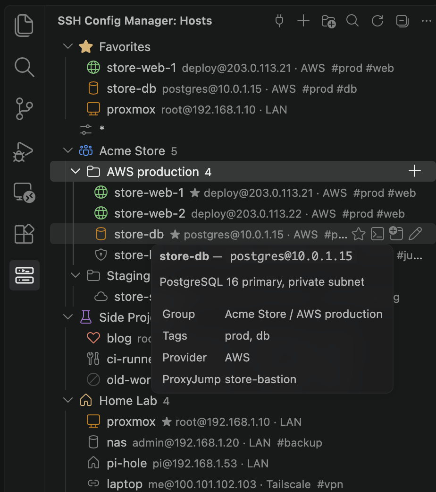
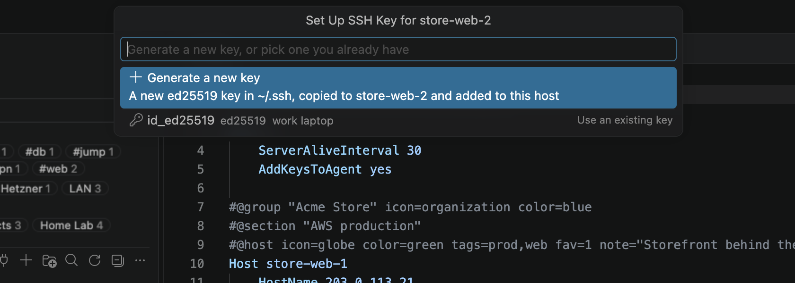
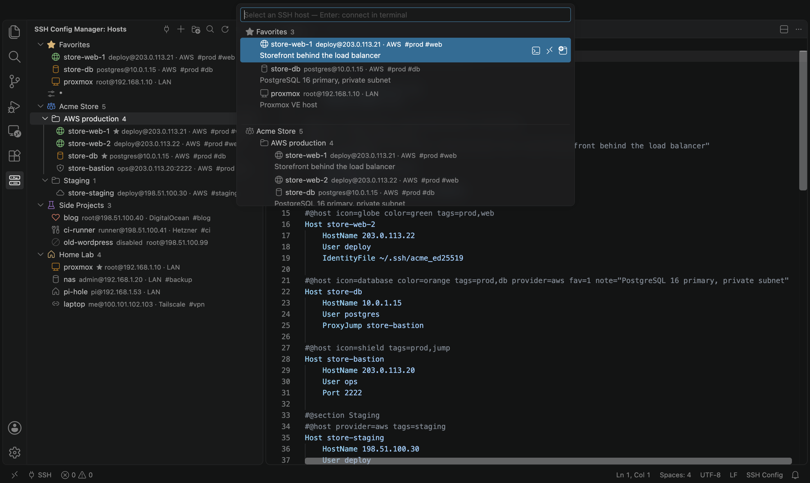
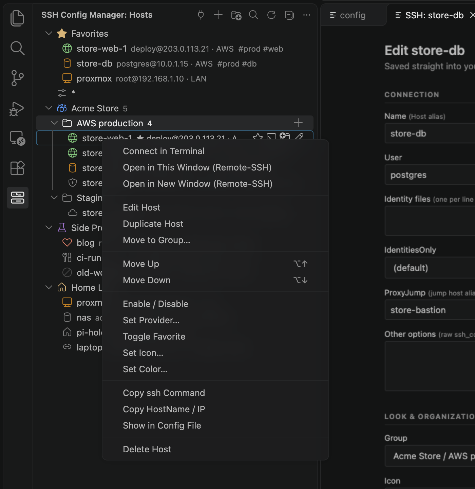
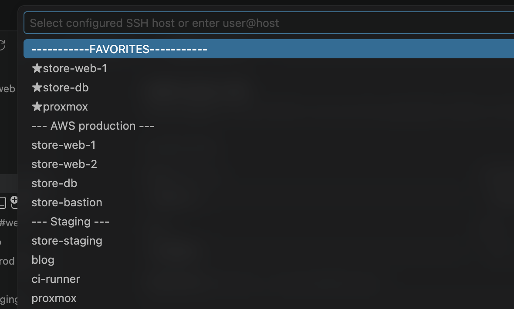

<p align="center">
  
</p>

<h1 align="center">SSH Config Manager</h1>

<p align="center">
  A side-bar GUI for your <code>~/.ssh/config</code> in VS Code: groups, icons, colors, tags, notes and favorites —<br>
  all stored as comments <b>inside the config file itself</b>.
</p>

<p align="center">
  <a href="https://marketplace.visualstudio.com/items?itemName=vrxt.ssh-config-manager"></a>
  <a href="https://marketplace.visualstudio.com/items?itemName=vrxt.ssh-config-manager"></a>
  <a href="https://github.com/VRXT/ssh-config-manager/actions/workflows/ci.yml"></a>
  <a href="LICENSE"></a>
</p>


The file stays the single source of truth. The extras are `#@…` comment lines that OpenSSH ignores,
so `ssh`, Remote-SSH and every other tool keep working, and the file syncs (git, OneDrive, Dropbox, …)
exactly as before.

## Features



- **Tree of hosts** by group and sub-group, showing `user@address`, provider, tags and a ★ for favorites
- **Favorites** pinned on top
- **Hover a host** for its note, group, tags, provider and jump host
- **Icons and colors** for hosts and groups
- **Provider detection**: LAN, Tailscale, AWS, Hetzner, DigitalOcean, Azure, Google Cloud, OVH, …
- **Search panel** that filters as you type, plus one-click filters by tag, provider and group
- **Set Up SSH Key…**: make a key (or pick one) and install it on the server in one step
- **Drag & drop** hosts between groups, or reorder with `Alt+↑` / `Alt+↓`
- **Enable / disable** hosts or whole groups without deleting them
- Hosts from `Include`d files are listed read-only
- A **timestamped backup** (last 20) is saved before every write

<br clear="right">

### Edit hosts in a form

HostName, User, Port, several IdentityFiles, ProxyJump, IdentitiesOnly, ForwardAgent and any raw extra
options. Only that host's lines are rewritten; every other line of the file is kept byte for byte.


### Search and filter


The **Search** panel sits above the host list:

- Type to filter instantly. Every word must match somewhere: name, HostName, User, Port,
  IdentityFile, ProxyJump or any other option, tags, note, group or provider.
- Click tags, providers and groups to narrow the list. Several picks in one row mean *any of them*;
  picks in different rows must *all* match.
- Folders open automatically while a search is on, and go back to how you left them when you clear it.

<br clear="right">

### Set up an SSH key in one step

Right-click a host → **Set Up SSH Key…**



1. **Generate a new key** (ed25519, saved in `~/.ssh`, optional passphrase) or **pick an existing one**.
2. The key is added to the host as `IdentityFile`.
3. A terminal opens and copies the public key to the server's `~/.ssh/authorized_keys`. Type the
   server password there once; after that the host logs in with the key.

It goes through `ssh <host>`, so `User`, `Port`, `ProxyJump` and the rest of the config apply. It works
on macOS, Linux and Windows, needs nothing installed on the server beyond a normal shell, and always
runs on your computer — also from a window that is connected to a remote.

### Connect your way

Connect in a terminal, or open the host in this / a new window through Remote-SSH, from the inline
buttons, the context menu, or the quick picker (`Cmd+Alt+S` on macOS, `Ctrl+Alt+S` elsewhere, or the
**SSH** button in the status bar).



<p>
  
  
</p>

The stock **Remote-SSH** picker can't be themed, so the extension can write a favorites block and spacer
rows into the file for it (right image). See [Tricks for the Remote-SSH picker](#tricks-for-the-stock-remote-ssh-picker).

## Getting started

1. Install **SSH Config Manager** from the Marketplace (or `ext install vrxt.ssh-config-manager`).
2. Click the server icon in the Activity Bar. Your existing `~/.ssh/config` is listed right away —
   nothing is converted or rewritten until you change something.
3. Use **+** to add a host, the folder button to add a group, and right-click anything for more.

To manage a different file, set `sshManager.configFile`.

## The comment format

```sshconfig
#@ssh-manager sort=name click=terminal

#@group "My Project" icon=cloud color=blue
#@section Hetzner

#@host icon=database color=green tags=prod,db fav=1 note="Main DB, internal 10.0.0.2"
Host HOST-db01
    HostName 203.0.113.10
    User root
```

| Line | Meaning |
|---|---|
| `#@ssh-manager k=v …` | Extension settings: `sort` (`file`/`name`), `click` (`none`/`terminal`/`window`/`newWindow`/`edit`), `favorites` (`on`/`off`), `autoicon` (`on`/`off`), `remote-favorites` (`off`/`on`) |
| `#@group NAME [icon= color=]` | Starts a group; runs until the next group. Quote names with spaces. |
| `#@section NAME [icon= color=]` | Starts a sub-group inside the current group |
| `#@host k=v …` | Must sit directly above a `Host` line: `icon`, `color`, `tags`, `note`, `fav`, `provider` |

### Disabled hosts and groups

**Enable / Disable** on a host or a group comments its lines out behind `#@off `, so neither `ssh`
nor the Remote-SSH picker sees them, while the tree still lists them (greyed, "disabled"):

```sshconfig
#@off Host HOST-old
#@off     HostName 203.0.113.99
```

Disabling a group does this for all its hosts, its `Host -----NAME-----` separator and the spacer row
above it. Enabling strips the prefix again and restores the lines exactly.

### Tricks for the stock Remote-SSH picker

Remote-SSH draws its own host list and cannot be themed, so these are written into the file:

- **Spacing** (command *Remote-SSH Picker Spacing…*): one `Host <invisible name>` line above each
  project gives an empty row between projects.
- **Favorites** (setting `remote-favorites=on`): starred hosts are copied into a generated
  `#@favorites-begin … #@favorites-end` block at the top, under `Host -----FAVORITES-----`, as
  `Host ★name` with the same options. The block is rebuilt after every edit made through the GUI;
  do not edit it by hand.

### Hand-written layouts are understood as they are

No conversion needed. These are read as groups / sub-groups:

```sshconfig
# ======================================================================
# PROJECT 1 - APEX                     <- banner = group
# ======================================================================
# --- HETZNER HOSTS ---                <- sub-group
Host -----------APEX-----------        <- separator host = group name (hidden from the host list)
    HostName 0.0.0.0
```

A banner followed by a separator host is one group, named after the separator. Giving such a group a
color or icon adds one `#@group` line above it; nothing else is rewritten.

## Settings

| Setting | Default | |
|---|---|---|
| `sshManager.configFile` | `~/.ssh/config` | Path of the SSH config file to manage |

Everything else lives in the file — use **⋯ → Settings** in the view.

## Keyboard shortcuts

| Shortcut | Action |
|---|---|
| `Cmd+Alt+S` / `Ctrl+Alt+S` | Connect to host… |
| `Alt+↑` / `Alt+↓` | Move the selected host or group (in the Hosts view) |

## Develop

```bash
npm install
npm test          # parser/editor tests; add a path to also check a real config: node test/parser.test.js ~/.ssh/config
npm run package   # builds the .vsix
```

Press `F5` in VS Code to run it in an Extension Development Host.

Issues and pull requests are welcome at
[github.com/VRXT/ssh-config-manager](https://github.com/VRXT/ssh-config-manager/issues).

## License

[MIT](LICENSE) © Mushari Alshqar
